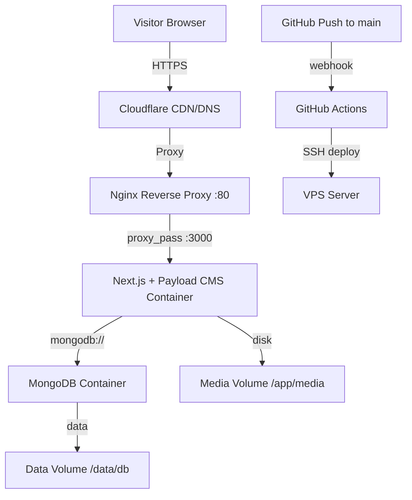

# 00 — Overview: Deployment & Rebranding Ponpes Abu Bakar Sidik

## Problem Statement

Website sekolah berbasis **Payload CMS + Next.js** saat ini berjalan di Vercel free tier (plan Hobby) dengan MongoDB Atlas free tier. Performa yang diberikan tidak cukup baik karena:

- **Cold start serverless** — Vercel serverless functions butuh waktu "bangun" setiap kali idle, menyebabkan loading lambat
- **MongoDB Atlas free tier (M0)** — shared cluster dengan RAM dan CPU terbatas, latensi tinggi
- **Vercel Blob Storage free tier** — terbatas 1GB

**Solusi:** Migrasi ke VPS self-hosted dengan Docker, beli domain `ponpesabubakarsidik.com`, dan hilangkan semua branding "Payload" dari frontend.

---

## Arsitektur Target

**Alur traffic:**
1. Visitor mengakses `ponpesabubakarsidik.com` via browser
2. Request diterima **Cloudflare** (CDN, DNS, SSL termination)
3. Cloudflare mem-proxy ke **Nginx** di VPS
4. Nginx meneruskan ke **Next.js + Payload CMS** container (port 3000)
5. App berkomunikasi dengan **MongoDB** container untuk data
6. Media files disimpan di **local disk volume**

**Alur deploy:**
1. Developer push ke branch `main` di GitHub
2. **GitHub Actions** trigger workflow
3. SSH ke VPS → pull code → rebuild Docker → restart containers

---

## Estimasi Biaya Bulanan

| Komponen | Provider | Harga |
|---|---|---|
| VPS (2 vCPU, 4GB RAM, 40GB SSD) | Hetzner CX22 | ~€4.35/bulan (~$5) |
| Domain `.com` | Cloudflare Registrar | ~$10.44/tahun (~$0.87/bulan) |
| DNS + CDN + SSL | Cloudflare Free | $0 |
| MongoDB | Self-hosted di VPS | $0 (included) |
| Media Storage | Local disk di VPS | $0 (included) |
| CI/CD | GitHub Actions Free | $0 |
| **Total** | | **~$6/bulan** |

Sebagai perbandingan, setup Vercel Pro + MongoDB Atlas dedicated (M10) akan menelan ~$78/bulan.

---

## Task List

| # | Task | File Panduan | Status |
|---|---|---|---|
| 1 | Buat utility `getSiteName` dan ubah default value | [`01-rebranding-sitename.md`](./01-rebranding-sitename.md) | ⬜ Belum |
| 2 | Wire `siteName` ke semua metadata dan SEO files | [`02-rebranding-metadata.md`](./02-rebranding-metadata.md) | ⬜ Belum |
| 3 | Update seed data dan test files | [`03-rebranding-seed-tests.md`](./03-rebranding-seed-tests.md) | ⬜ Belum |
| 4 | Konfigurasi Next.js untuk Docker standalone output | [`04-docker-standalone.md`](./04-docker-standalone.md) | ⬜ Belum |
| 5 | Buat production Docker Compose setup | [`05-docker-compose-production.md`](./05-docker-compose-production.md) | ⬜ Belum |
| 6 | Buat GitHub Actions CI/CD pipeline | [`06-github-actions-cicd.md`](./06-github-actions-cicd.md) | ⬜ Belum |
| 7 | Dokumentasi setup VPS & domain | [`07-vps-domain-setup.md`](./07-vps-domain-setup.md) | ⬜ Belum |

**Urutan eksekusi yang direkomendasikan:**
1. Task 1-3 (Rebranding) — bisa dikerjakan duluan tanpa VPS
2. Task 4 (Docker standalone) — persiapan build
3. Task 5 (Docker Compose) — konfigurasi production
4. Task 7 (VPS & Domain) — setup infrastruktur
5. Task 6 (CI/CD) — otomasi deploy setelah infra ready

---

## Tech Stack

| Layer | Teknologi |
|---|---|
| Frontend | Next.js 16, React 19, Tailwind CSS 4 |
| CMS | Payload CMS 3.90 |
| Database | MongoDB 7 (self-hosted) |
| Reverse Proxy | Nginx Alpine |
| Container | Docker + Docker Compose |
| CDN/DNS/SSL | Cloudflare (Free) |
| CI/CD | GitHub Actions |
| Domain Registrar | Cloudflare Registrar |
| VPS | Hetzner Cloud CX22 |
